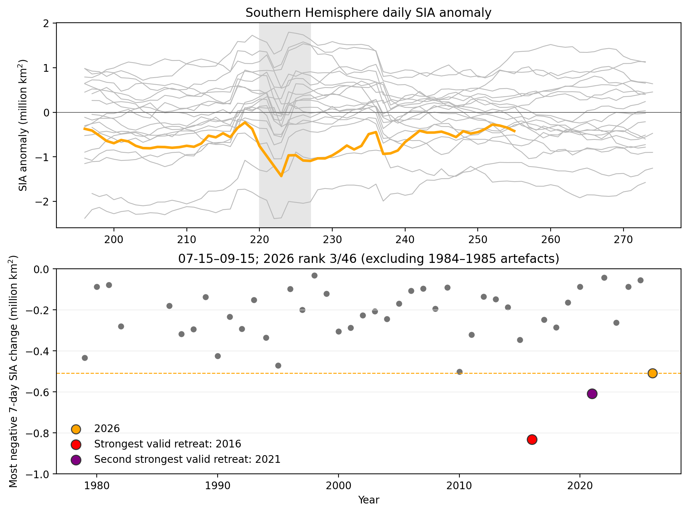
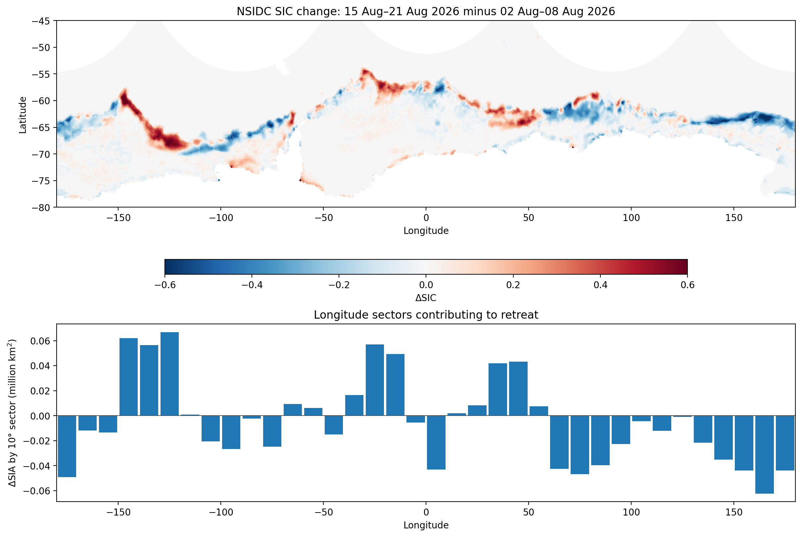
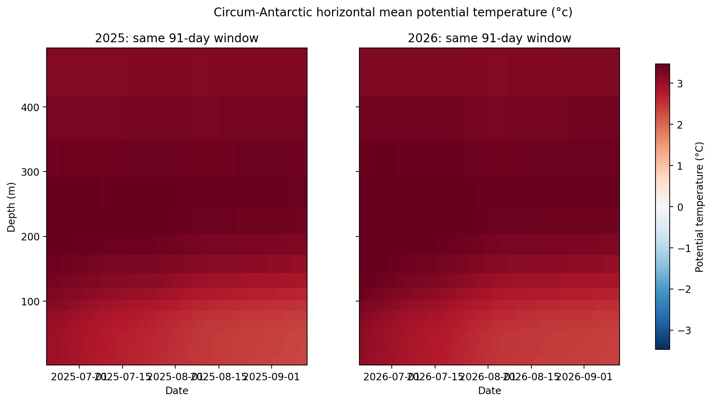
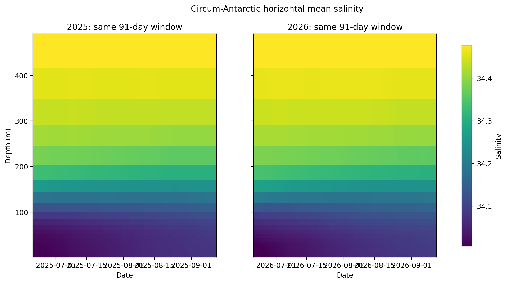

# Southern Hemisphere sea-ice-area retreat — August–September 2026

This meeting note investigates the sharp Southern Hemisphere sea-ice-area (SIA) retreat in mid-August 2026 and the subsequent recovery.

## 1. How unusual was the event?

Using daily NSIDC G02202 V6 SIA, the event is defined as the most negative 7-day SIA change between 07-15 and 09-15.

- Event interval: **08 Aug 2026 to 15 Aug 2026**
- 7-day SIA change: **-0.509 million km²**
- Rank among annual seasonal minima: **3 of 46**
- Percentile among all seasonal 7-day changes: **0.3th percentile** (lower = stronger retreat)

## 2. Where did the retreat occur?

The map compares 7-day means immediately before and after the objectively detected retreat. The lower panel integrates ΔSIA into 10° longitude sectors.

Largest negative 10° sector contributions:

- +160° to +170°: -0.062 million km²
- -180° to -170°: -0.049 million km²
- +70° to +80°: -0.047 million km²
- +150° to +160°: -0.044 million km²
- +170° to +180°: -0.044 million km²

## 3. Ocean context: upper 500 m

These sections are area-weighted horizontal Southern Ocean means from CMEMS 1/12° Global Ocean Physics Analysis and Forecast, comparing the latest 91-day window with the same calendar interval one year earlier.

### Potential temperature

### Salinity

## 4. Next iteration

Weekly ERA5/ERA5T files are staged with daily `t2m`, `d2m`, derived `rh2m`, `msl`, `u10`, `v10`; CMEMS weekly sea-ice files contain `siconc`, `sithick`, `usi`, `vsi`, `sialb`, `siage`, `sisnthick`.

Next diagnostics should test the retreat sectors against wind/MSLP anomalies, ice-drift divergence/convergence, and sector-resolved upper-ocean temperature/salinity to separate dynamic from thermodynamic contributions.
